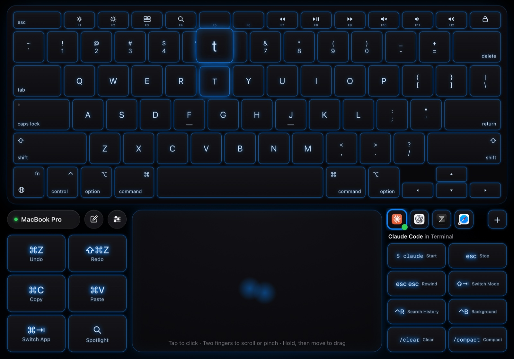
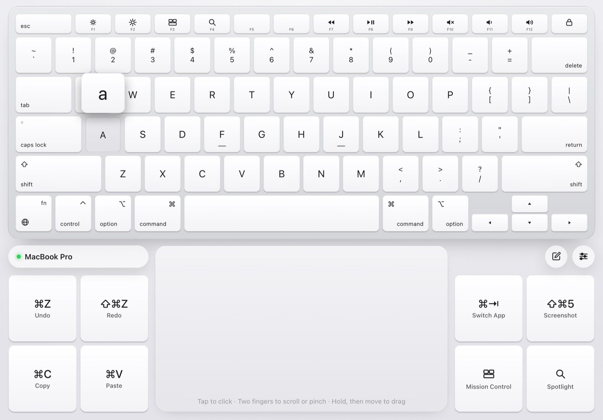
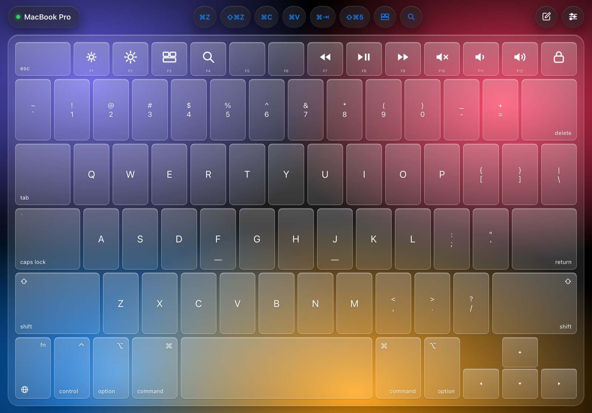
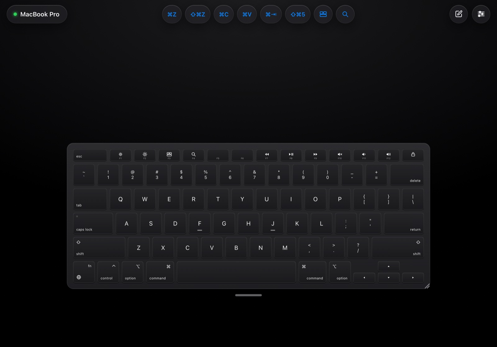
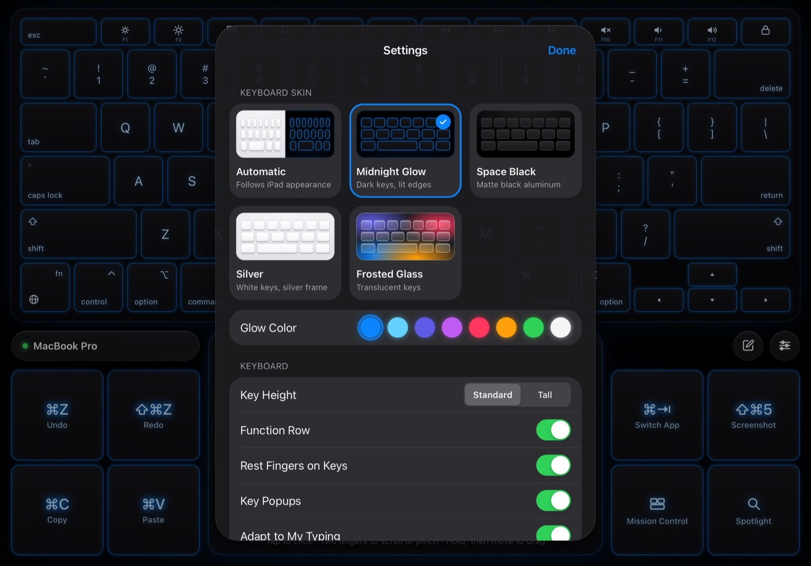
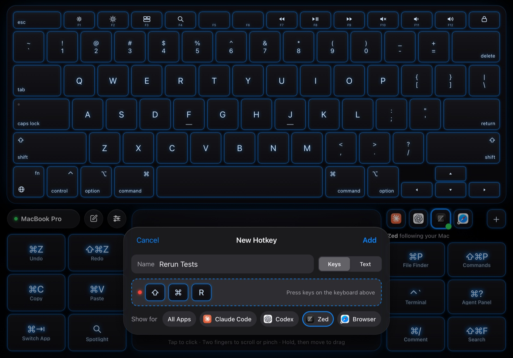
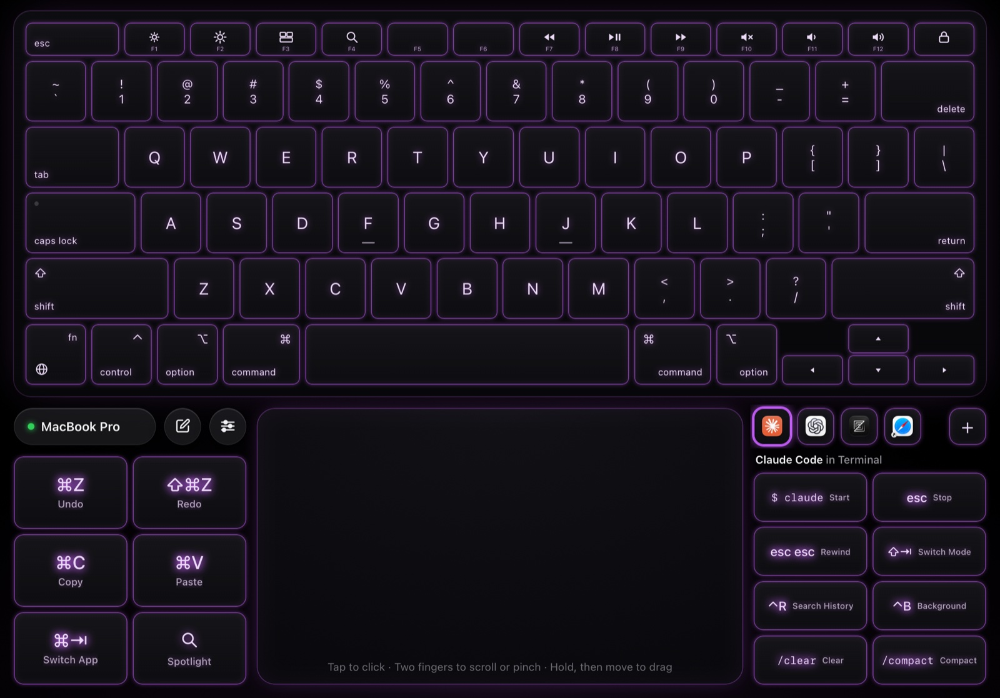

<h1 align="center">Tactile</h1>

<p align="center">
  <b>Turn your iPad into a Magic Keyboard and trackpad for your Mac.</b><br>
  Full Mac layout, real key sounds, trackpad gestures. No app to install on the iPad, no accounts, no dependencies.
</p>

<p align="center">
  <a href="https://github.com/KukretiShubham/tactile-keyboard/actions/workflows/checks.yml"></a>
  <a href="https://github.com/KukretiShubham/tactile-keyboard/releases/latest"></a>
  
  
  
  
</p>

<p align="center">
  
</p>

Put your Mac on a stand, keep the iPad in front of you, and type and point with it like a laptop. Tactile is a tiny menu bar app for the Mac and a web page for the iPad. Scan a QR code and you're typing; there's nothing to install from the App Store.

## Why Tactile

- **It's a real Mac keyboard.** Function row with media keys, the number row, ⌃ ⌥ ⌘ and fn, inverted-T arrows, rows that line up like a Magic Keyboard. Keys show your Mac's own layout (AZERTY, QWERTZ and others) and switch when you do.
- **It feels like typing.** iPads have no vibration motor, so every key plays a synthesized key sound (Soft, Crisp or Thock), coming from the side of the keyboard the key is on. Letters pop up above your finger, like on the iPhone.
- **It learns your aim.** Glass has no edges to feel, so Tactile quietly learns where you actually press each key and shifts its touch area to match.
- **Rest your fingers.** Fingers resting on the keys don't type; keys type when you lift. Rolled keys still come out in the right order.
- **A proper trackpad.** Tap to click, two-finger click, two-finger scroll with momentum, pinch to zoom, drag, three-finger drag, and swipes for Spaces, Mission Control and App Exposé.
- **Laid out like a MacBook.** In landscape the trackpad sits centred below the keyboard, and the palm rests either side hold big shortcut keys: Undo, Redo, Copy, Paste, Switch App, Spotlight and more. You pick which.
- **Hotkeys for the apps you code in.** Ready-made keys for Claude Code, Codex, VS Code, Zed, Xcode, JetBrains IDEs and browsers, shown with each app's own icon. They switch to whichever app you're using on the Mac, and you can record your own.
- **Private and secure.** Everything stays between your iPad and your Mac, encrypted with TLS. Pairing takes a one-time code, and over Tailscale only your own devices can connect.
- **Nothing to patch.** No third-party packages on either side: Apple frameworks on the Mac, plain HTML, CSS and JavaScript on the iPad.

## Screenshots

| | |
|---|---|
|  |  |
| **Silver**, with a key popup | **Frosted Glass**, keyboard only and expanded |
|  |  |
| **Floating** keyboard: drag the handle to move it, the corner to resize it | **Settings**: skins, glow colors, sounds, trackpad and layout |

Make your own hotkeys: record a key combination right on the keyboard, or send text like `/review`:

<p align="center"></p>

Midnight Glow comes in eight glow colors:

<p align="center"></p>

## Getting started

You need a Mac with **macOS 15 or later**, plus an iPad (any device with a modern browser works) on the same Wi-Fi network or the same [Tailscale](https://tailscale.com) network.

### Download (easiest)

1. **Download** `Tactile-<version>.zip` from the [latest release](https://github.com/KukretiShubham/tactile-keyboard/releases/latest), unzip it, and move **Tactile.app** to Applications. It runs on Apple silicon and Intel Macs.
2. **Open it the first time:** Tactile is free and open source, so it isn't notarized by Apple, and macOS blocks it at first. Open it once, then go to System Settings → Privacy & Security, scroll down, and click **Open Anyway** next to Tactile.
3. **Allow Accessibility:** macOS asks you to allow Tactile in System Settings → Privacy & Security → Accessibility. Every app that types or moves the pointer needs this.
4. **Pair your iPad:** click the Tactile icon in the menu bar, choose **Pair a Device…**, and scan the QR code with the iPad's camera. With Tailscale, the scan pairs too; on Wi-Fi only, type the six-digit code it shows (see below).

Then tap Share → **Add to Home Screen** on the iPad for a full-screen app without Safari's toolbar.

When you install a newer version, switch Tactile off and on again under Accessibility: macOS treats each download as a new app.

<details>
<summary>Check that a download is genuine</summary>

Each release lists a SHA-256 checksum next to the zip; compare it with:

```sh
shasum -a 256 Tactile-v<version>.zip
```

Releases are built by GitHub Actions from the tagged code, with a signed build provenance attestation. With the [GitHub CLI](https://cli.github.com):

```sh
gh attestation verify Tactile-v<version>.zip --repo KukretiShubham/tactile-keyboard
```

</details>

### Build it yourself

1. **Install Apple's developer tools**, if you don't have Xcode. You need Xcode 16 or the Command Line Tools 16 or later (they include the Swift 6 toolchain):
   ```sh
   xcode-select --install
   ```
2. **Download the code:**
   ```sh
   git clone https://github.com/KukretiShubham/tactile-keyboard.git
   cd tactile-keyboard
   ```
3. **Build and open it:** double-click `start-tactile.command` (or run `./start-tactile.command`). It builds **Tactile.app** and opens it in your menu bar. The first build takes a few minutes. You can move `build/Tactile.app` to Applications afterwards.
4. Allow Accessibility and pair your iPad, as in steps 3 and 4 above.

### Connecting over Tailscale (recommended)

With [Tailscale](https://tailscale.com) on both devices, Tactile gets a real HTTPS certificate for your Mac, so there's nothing to install on the iPad, and it works away from home too.

1. In the Tailscale admin console, turn on **MagicDNS** and **HTTPS Certificates** (a one-time step).
2. Open Tactile and choose **Pair a Device…**. The QR code opens your Mac's Tailscale address, such as `https://your-mac.your-tailnet.ts.net:8423`, and pairs in one scan.

Public certificates are listed in public Certificate Transparency logs, so your Mac's Tailscale name becomes publicly visible.

### Connecting over Wi-Fi only

Without Tailscale, Tactile uses its own certificate, which each iPad trusts once:

1. Scan the QR code to open the setup page in Safari.
2. Follow the steps there: download the certificate, install the profile in Settings (check that its SHA-256 fingerprint matches the one in Tactile's menu; hold ⌥ while opening it), and turn on full trust under General → About → Certificate Trust Settings.
3. Open Tactile and type the six-digit pairing code from the Mac. The iPad is remembered from then on.

On Wi-Fi only, the QR code never carries the pairing code: the setup page is plain HTTP, so you type the code on the encrypted page instead.

### Keep Accessibility allowed when you rebuild it yourself

macOS ties the Accessibility permission to the app's signature. To avoid approving Tactile again after every update, run this once:

```sh
scripts/create-signing-certificate.sh
```

It creates a self-signed "Tactile Local Signing" certificate in your login keychain, and every build is signed with it from then on. After creating it, approve Tactile once more: run `tccutil reset Accessibility app.tactile.mac`, open Tactile, and switch it on. If macOS asks whether `codesign` may use the key, enter your password and choose **Always Allow**.

## Using it

| On the iPad | On the Mac |
|---|---|
| Tap a modifier (⇧ ⌃ ⌥ ⌘ fn) | Applies to the next key, like the iPad keyboard |
| Double-tap a modifier | Locks it until you tap it again |
| Hold a modifier and tap a key | A normal shortcut (⌘-Tab stays open while held) |
| fn + delete / arrows | Forward delete, Page Up/Down, Home/End |
| fn + top row | F1–F12 instead of media keys |
| Compose button (top right) | Type with the iPad's own keyboard, for dictation, emoji and autocorrect |

| On the trackpad | |
|---|---|
| Tap / two-finger tap | Click / secondary click |
| Two fingers | Scroll, with momentum |
| Pinch | Zoom in or out in the app you're using |
| Hold, then move | Drag (or three fingers, with Three-Finger Drag on) |
| Three fingers left, right, up, down | Switch Spaces, Mission Control, App Exposé |

A hardware keyboard attached to the iPad is passed through to the Mac too.

### Settings on the iPad

Tap the settings button (top right):

- **Keyboard skin:** Midnight Glow (eight glow colors), Space Black, Silver, Frosted Glass, or Automatic.
- **Keyboard:** Key Height, Function Row, Rest Fingers on Keys, Key Popups, **Adapt to My Typing** (with Reset Typing Learning), and **Match Mac Layout**.
- **Shortcuts:** turn them on or off and choose which appear. In landscape with the trackpad they're keys on the left of the trackpad; otherwise they sit along the top. Letter shortcuts follow your Mac's layout, so ⌘Z is still ⌘Z on AZERTY.
- **App Hotkeys:** **Follow My Mac's App** switches the hotkeys beside the trackpad to the app in front on the Mac. **Apps** has a switch per app, to hide the tabs you don't use. **My Hotkeys** lists the hotkeys you made, to delete them.
- **Feedback:** key sounds, Soft, Crisp or Thock, volume, Sound in Silent Mode, and vibration on devices that have it.
- **Trackpad:** tracking speed, scrolling speed, natural scrolling, Pinch to Zoom, Three-Finger Drag.
- **Layout:** keyboard, trackpad or both (in landscape, both gives the MacBook-style layout with the trackpad centred); keyboard at the top, middle or bottom; **Expanded** or **Floating** keyboard; **Keep Screen Awake** (the iPad stays on while you use it, and sleeps normally after 10 idle minutes).

### App hotkeys

In landscape with the trackpad showing, the right side of the trackpad has a row of app tabs, each with that app's hotkeys: Claude Code, Codex, VS Code, Zed, Xcode, JetBrains IDEs and browsers. They follow the app in front on your Mac, tapping a tab brings that app forward, and a second tap closes what a hotkey opened. Tap **+** to record your own. The full list and how each one behaves is in [docs/app-hotkeys.md](docs/app-hotkeys.md).

### The menu bar

Click the Tactile icon in the menu bar to see connected devices with their connection quality, and to:

- **Pause Input** (also **⌃⌥⌘P** from any app), or pause automatically while the Mac is locked
- **Disconnect**, **Reconnect** or **Revoke** a device
- turn Tailscale, **Only My Devices on Tailscale**, connection notifications and **Open at Login** on or off
- **Pair a Device…** (⌘P) or **Copy Tailscale Link**

Hold ⌥ while opening it for details: addresses, ports, certificate fingerprint and the log.

## Security and privacy

Tactile can type on your Mac, so it's built to be careful:

- **Encrypted:** everything travels over TLS. The keyboard page and its connection refuse plain HTTP, and only the Mac's own page may connect.
- **Paired, not open:** a new device needs a six-digit code that works once, and only ever travels over HTTPS. Wrong guesses lock out quickly. Remembered devices hold a random 256-bit token that the Mac stores only as a hash, and expire after 90 days unused.
- **Only your devices on Tailscale:** Tactile asks Tailscale who owns each device and refuses anything not signed in as you, before it can even try to pair.
- **A limited certificate:** the local certificate authority can only vouch for `.local` names and private addresses, so it can't be used to impersonate websites.
- **Nothing leaves your network:** no accounts, no analytics, no cloud service. What Adapt to My Typing learns stays on the iPad. Your paired iPad is told the name of the app in front on the Mac, for app hotkeys.

Found a security problem? Please report it privately, as described in [SECURITY.md](SECURITY.md).

## Troubleshooting

- **"Mac not reachable":** check that both devices are on the same network (guest and some office networks keep devices apart; Tailscale avoids this), that you allowed Tactile when macOS asked about incoming connections, and that nothing else uses ports 8420–8424 (or start Tactile with `--port`).
- **Keys or the pointer do nothing:** check that Tactile is switched on under System Settings → Privacy & Security → Accessibility. After installing a new version, switch it off and on again.
- **No key sounds:** Safari only plays sound after a tap; tap **Tap to enable key sounds** at the top. Check the volume, and **Sound in Silent Mode** if the iPad is muted.
- **The Tailscale address is missing:** turn on MagicDNS and HTTPS Certificates in the Tailscale admin console, and make sure Tailscale is running on the Mac. Tactile adds the address as soon as Tailscale issues the certificate.
- **"Not allowed" over Tailscale:** with **Only My Devices on Tailscale** on, the iPad must be signed in to Tailscale as the Mac's owner.
- **Anything else:** hold ⌥ while opening Tactile's menu and choose **Show Log** (it's `~/Library/Logs/Tactile.log`), then [open an issue](https://github.com/KukretiShubham/tactile-keyboard/issues/new/choose) with what you see.

## FAQ

**Do I need to install anything on the iPad?**
No. Tactile runs in Safari. Add it to the Home Screen for a full-screen app.

**Does it work with an iPhone, an Android tablet, or another computer's browser?**
Yes, anything with a modern browser can connect. The layout is designed for iPads in landscape.

**Why sounds instead of vibration?**
iPads don't have a vibration motor. Devices that do vibrate on each key.

**Does it work with Windows or Linux?**
Not yet. The Mac side uses macOS APIs to send keystrokes and pointer movement.

**Does it slow down my Mac or drain the iPad?**
The Mac app idles in the menu bar. On the iPad, the screen is allowed to sleep after 10 minutes without a touch.

## For developers

```sh
swift build                      # build everything
swift run tactile-checks         # Swift checks, plus the web tests in WebKit
swift run -c release Tactile     # run in a terminal (prints the QR code)
swift run Tactile --dry-run      # log input instead of controlling the Mac
swift run Tactile --help         # other options: --port, --no-tailscale, --forget-devices
```

Tactile builds with the Swift 6 toolchain (Xcode 16 or Command Line Tools 16+); the code still uses the Swift 5 language mode.

| Folder | What's there |
|---|---|
| `Sources/TactileCore/` | Everything but the menu bar UI: pairing and certificates (`Security/`), the web and WebSocket servers (`Network/`), turning messages into keystrokes and pointer events (`Input/`), and shared helpers (`Support/`). |
| `Sources/Tactile/` | The menu bar app. `Web/` is the iPad page: `keys.js` (layout), `keyboard.js` (typing), `typing-model.js` (learned touch areas), `trackpad.js`, `shortcuts.js`, `packs.js` and `hotkeys.js` (app hotkeys), `hotkey-editor.js`, `feedback.js` (sounds) and more. |
| `Tests/` | `TactileChecks/` (Swift checks) and `Web/` (tests for the page). |
| `scripts/`, `Packaging/` | Building and signing `Tactile.app`. |

```
iPad Safari ── HTTPS + secure WebSocket ──▶ Tactile (menu bar app) ──▶ macOS keyboard and pointer events
```

## Contributing

Bug reports, ideas and pull requests are welcome: see [CONTRIBUTING.md](CONTRIBUTING.md), and the [changelog](CHANGELOG.md) for what's new. Everyone taking part is expected to follow the [code of conduct](CODE_OF_CONDUCT.md). If Tactile is useful to you, a ⭐ helps others find it.

## License

[MIT](LICENSE). Not affiliated with Apple. Mac, iPad, Magic Keyboard and Safari are trademarks of Apple Inc.
